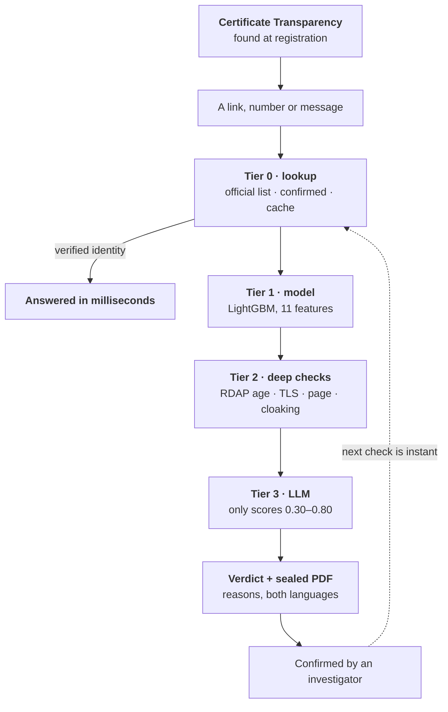
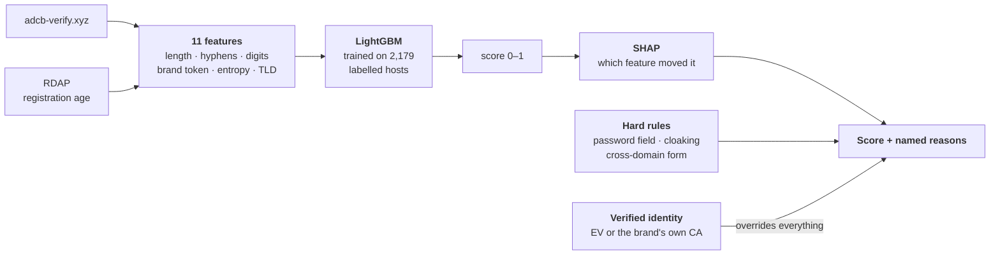
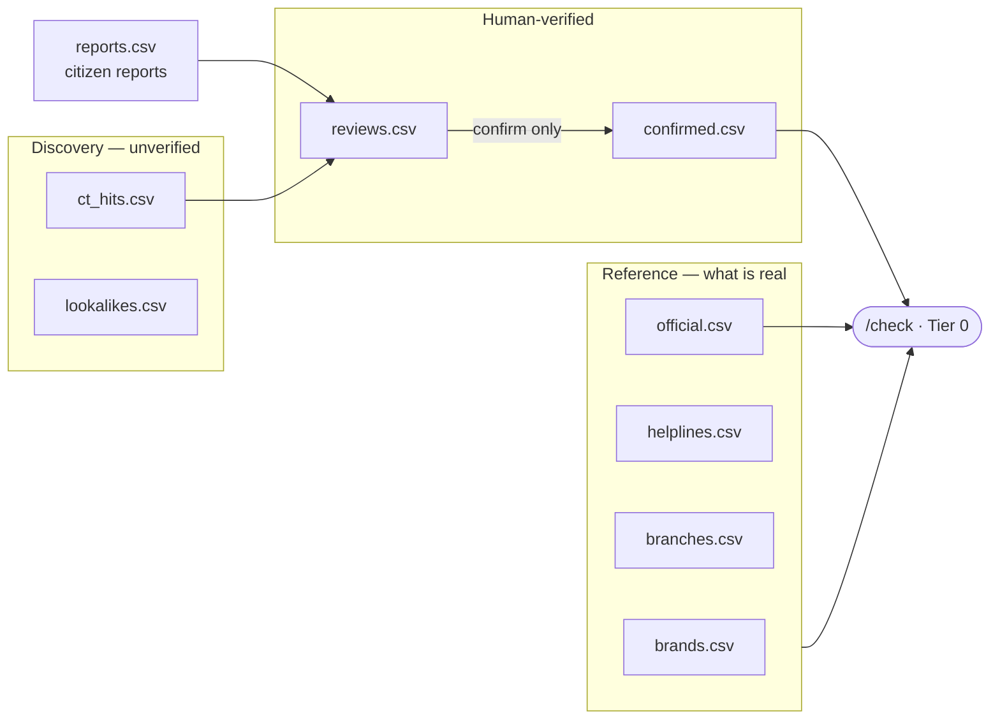
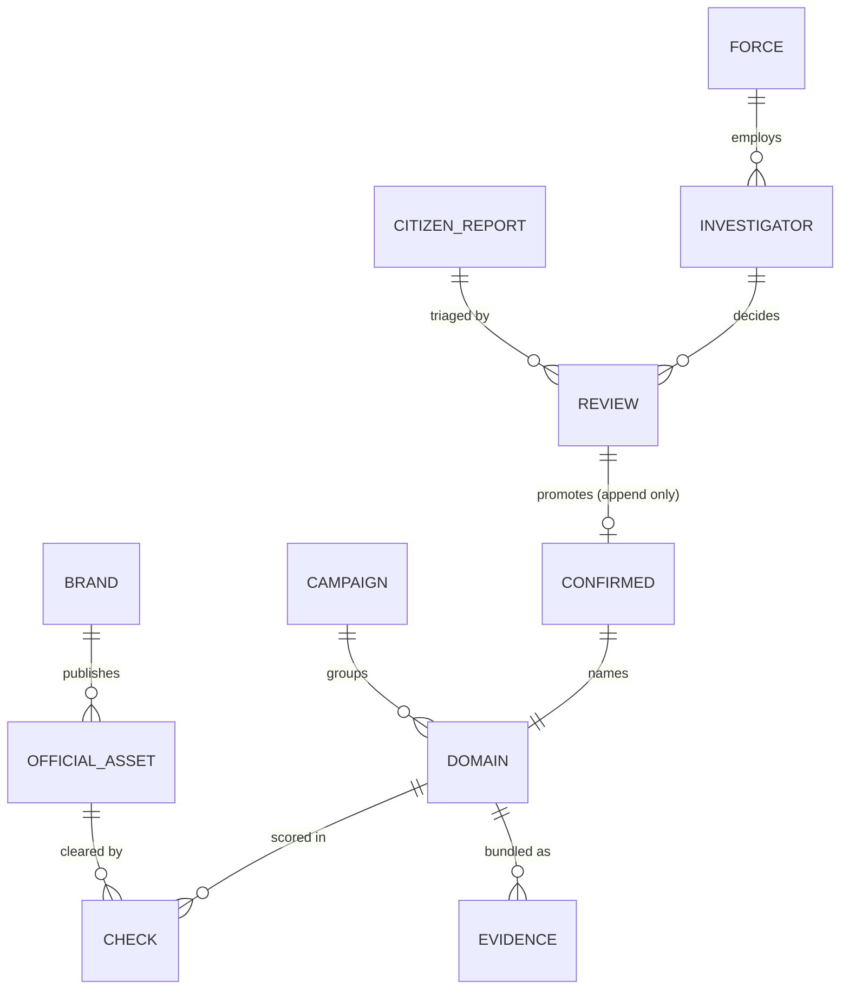
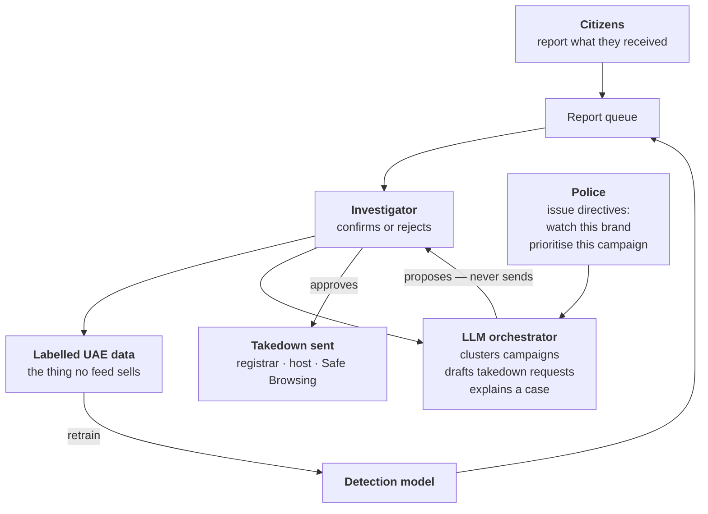

# Hirz · حِرز

**Scam detection for the UAE, in Arabic and English — with evidence a police
investigator can act on.**

Built for the ScamShield AI Hackathon · 42 Abu Dhabi × Abu Dhabi Police.

---

## The problem

A message arrives: *"Your ADCB account is suspended. Verify now."* The link looks
close enough. By the time anyone reports it, the money is gone and the domain is
days old.

Three things make this hard in the UAE specifically:

1. **Reports arrive too late.** Blocklists are built from victims. The first
   person to click is never protected.
2. **Real sites get flagged.** A detector that cries wolf on `adcb.com` or
   `tamm.abudhabi.gov.ae` is worse than none — people stop believing it.
3. **The scams are bilingual, the tools are not.** An Arabic SMS impersonating
   TAMM is invisible to an English-only classifier.

## The solution

Hirz checks a **link**, a **phone number**, a **whole SMS or WhatsApp message**,
or a **business listing**, and answers in the reader's language with the reasons
behind the score. Anything suspicious can be reported in one tap; an
investigator confirms it and exports a hashed, timestamped, bilingual PDF ready
for a takedown request.

It finds fake domains **by watching public certificate logs** — at registration,
before any victim exists.

---

## How a check runs

Four tiers. Each one stops as early as it can, so the expensive work stays rare.



| Tier | Does | Speed |
|---|---|---|
| 0 | Official allowlist, confirmed scams, cache | instant |
| 1 | Lexical + domain features, LightGBM — 0.875 accuracy, 0.931 AUC | ~50 ms |
| 2 | RDAP age, TLS certificate, page forms, hotlinks, cloaking probe | 5–10 s |
| 3 | LLM adjudication, ambiguous band only, via Ollama | 3–8 s |

Tier 3 never clears what a hard rule flagged, and the system runs unchanged when
Ollama is absent.

### How the model reaches a score



The model never speaks alone. A hard rule can condemn a page the model liked,
and proven identity clears a page the model disliked — which is how
`dpdhl.com` stopped being called malicious.

## Where the innovation is

**Certificate Transparency as an early-warning feed.** Every HTTPS certificate
issued anywhere is published to public logs within minutes. A scammer registering
`adcb-verify.xyz` and fetching a certificate announces themselves before sending
a single SMS.

**Certificate issuer as proof of ownership.** A certificate issued by
`O=Deutsche Post AG` came from DHL's own internal CA — an attacker cannot obtain
one. Extended Validation certificates work the same way: verified legal identity
ends the check. This is what took our watchlist from 558 flagged domains to 33.

**Cloaking detection.** Each page is fetched twice — once as a browser, once as a
crawler — and compared. Scam pages routinely serve something harmless to search
engines and the phishing form to real visitors.

**Bilingual explanations, not bilingual labels.** The reasons themselves are
Arabic in Arabic mode. Sentences the server composes carry a `text_ar` built by
pattern, so numbers and brand names survive translation.

**A closed loop.** An investigator confirms a report → that domain enters the
confirmed list → the next person to check it gets an instant answer.

---

## What it does

| Surface | What a person can do |
|---|---|
| **Link** | Check a URL. Official domains return green instantly |
| **Number** | Check a phone number against published helplines |
| **Message** | Paste a whole SMS or WhatsApp text — every link, number and address inside is checked |
| **Listing** | Cross-check a business listing's phone and address against the brand's real ones |
| **Report** | Send a scam to the investigation queue with our verdict attached |
| **Console** | Investigator queue, case detail, evidence PDF, takedown routing — Arabic and English |

---

## Technical choices

| Area | Choice | Why |
|---|---|---|
| Model | LightGBM, 11 features | Fast, interpretable, strong on tabular data |
| Explanations | SHAP + rule codes | Every score has named reasons |
| Registration | **RDAP** via IANA bootstrap | crt.sh rate-limited us 1,343× — RDAP raised coverage 9% → 79% |
| Domain parsing | `tldextract` (Public Suffix List) | Anchored matching; `du` must not match "education" |
| Early warning | Certificate Transparency (crt.sh) | Finds domains at registration |
| Page analysis | BeautifulSoup + structural fingerprints | Compares a page to the real brand's |
| Phone numbers | `phonenumbers` + UAE numbering rules | 800/600 vs 05x tells you a lot |
| Evidence PDF | `fpdf2` + DejaVu Sans | Arabic Presentation Forms, no external shaping library |
| LLM tier | Ollama, local | No data leaves the machine |
| API | FastAPI + uvicorn | Typed, self-documenting at `/docs` |

### APIs and data

| Source | Used for | Key needed |
|---|---|---|
| RDAP (IANA bootstrap) | Domain registration age | No |
| crt.sh | Certificate Transparency | No |
| Team Cymru DNS | ASN and hosting | No |
| rdap.org | Network abuse contacts | No |
| Nominatim (OSM) | Listing address verification | No |
| urlscan.io | Evidence screenshot | Optional — degrades honestly |
| Brave Search | Listing web footprint | Optional |
| Google Places | Live Maps listings | Optional — fixture otherwise |

**Training data:** 2,179 labelled hosts from public phishing feeds, balanced
1,091 scam / 1,088 legitimate. See *Honest limitations* below.

---

## Build and run

```powershell
python -m venv .venv
.venv\Scripts\Activate.ps1          # Windows
pip install -r requirements.txt
```

The model ships in the repo, so you can start straight away. **Two servers:**

```powershell
# Terminal 1 — the checker API
python -m uvicorn api:app --port 8000
```

```powershell
# Terminal 2 — the citizen app
python -m uvicorn hirz_server:app --host 0.0.0.0 --port 8001
```

| Open | For |
|---|---|
| http://localhost:8001 | Citizen app |
| http://localhost:8000 | Investigator console |
| http://localhost:8000/docs | API reference |

On a different port for the API, set `HIRZ_API` in terminal 2 before starting
it: `$env:HIRZ_API = "http://127.0.0.1:8010"`.

<details>
<summary>Optional setup</summary>

```powershell
python listing_scan.py        # build the listing demo data (once, ~1 min)
python reference_pages.py     # fingerprint real brand pages for similarity
python features.py            # rebuild features from the dataset
python train.py               # retrain the model, prints precision/recall/AUC
```

Environment variables, all optional: `URLSCAN_API_KEY` (evidence screenshots),
`BRAVE_API_KEY` (listing web footprint), `NOMINATIM_EMAIL`, `GOOGLE_PLACES_KEY`,
`HIRZ_INVESTIGATOR_TOKEN` (requires a header for confirm/reject when set).

Deployment to Render is covered in [DEPLOY.md](DEPLOY.md).
</details>

---

## Where the data lives



**Discovery never auto-promotes.** A human clicks Confirm in the console, or it
stays `REPORTED`. `reviews.csv` is the audit trail of every decision.

---

## Results

| | |
|---|---|
| Model, held-out split | **0.875 accuracy · 0.931 AUC** |
| Watchlist false positives removed | **558 flagged → 33** |
| RDAP coverage vs crt.sh | **79% vs 9%** |
| Reason codes with Arabic | **100%** of composed rules |

The 558 → 33 result is the one we are proudest of. Among the domains we had been
calling malicious at score 99 was `dpdhl.com` — Deutsche Post DHL Group's own
corporate domain. Four rules removed 525 false positives: brand-name substring
matches, private-CA certificates, identity-checked OV certificates, and brand
top-level domains like `.dhl`.

---

## Where this goes next

Everything below is **proposed, not built**. It is the design we would take into
a police pilot, and the reason the current code keeps its storage and its
decisions behind single functions.

### The database, in production

Today the stores are CSV files — right for one investigator, wrong for a force.
The shape they would take:



Three properties matter more than the schema. **`CONFIRMED` is append-only** —
a confirmation is a decision on the record, and decisions are not quietly
deleted. **Every row carries who decided and when**, because the output is
meant for a court. **Campaigns group domains**, so taking down one scam takes
down the twelve registered beside it.

### Learning from the people who get targeted

The loop that exists today stops at the confirmed list. The one we want keeps
going:



**Every report a citizen files is a label nobody can buy.** Public phishing
feeds are global; a stream of real UAE reports, triaged by a real investigator,
is the training data that would make this specifically good at Emirates NBD and
TAMM rather than generically good at PayPal.

**The orchestrator proposes and a human disposes.** It would cluster related
domains, draft the takedown request, and explain a case in either language — but
it does not send, confirm, or decide. An investigator approves every action that
leaves the building. That is not a limitation we are working around; it is the
only arrangement that makes the output usable as evidence.

**Police set direction, not verdicts.** An officer should be able to say *watch
these four banks this week* or *prioritise anything on this campaign* and have
the system reorder its work — without being able to mark something confirmed
without review.

## Honest limitations

**No real UAE fraud data exists outside the banks and the police.** We trained on
public phishing feeds, which are global — PayPal, DHL, Netflix — because that is
what is publicly labelled. Our features are structural rather than
brand-specific, so they should transfer, but we cannot prove it without the data.

**We have no independent UAE benchmark.** The numbers above are measured on our
own held-out split. We would rather say that than quote a figure against a test
set we do not have.

**The domain watcher covers global brands, not UAE ones yet.** It finds DHL and
PayPal lookalikes because that is where public certificate volume is. Adding
Emirates NBD, ADCB, TAMM and UAE PASS is configuration, not redesign.

**Confirmed scams live in files, not a shared database.** Correct for one
investigator; wrong for a force. The read path is a single function, so this is
a swap rather than a rewrite.

**A report naming only a phone number gets no evidence PDF.** The bundle is built
from a website's registration, certificate and hosting. A number has none of
those and needs its own evidence type — we show the user why rather than
offering a button that fails.

**Screenshots and live Maps data need paid keys.** Both degrade honestly: the
bundle records *"No screenshot: API key not configured"* rather than fabricating
an image, and listings fall back to hand-collected fixtures.

**The LLM tier runs locally**, so it is skipped on free cloud hosting. The other
three tiers are unaffected — the design degrades rather than breaks.

---

## Repository

```
api.py              the checker API — four tiers, reports, evidence
hirz_server.py      serves the citizen app, proxies to the API
tier2.py            RDAP, TLS, page facts, cloaking probe
features.py         lexical and domain features
train.py            trains data/model.pkl
evidence.py         hashed bundle + bilingual PDF + takedown routing
listing_scan.py     business listing cross-checks
ct_watch.py         Certificate Transparency watcher
clean_detections.py false-positive filters (558 → 33)
clients/            index.html (citizen app) · dashboard.html (console)
data/               reference data, model, confirmed/reports/reviews
```

Research scripts — `hunt_lookalikes.py`, `favicon_pivot.py`,
`campaign_clusters.py`, `pivot.py`, `lead_time.py` — find scams nobody reported
and are documented in [CONTRACT.md](CONTRACT.md).

---

## Not a police system

Hirz is a prototype. The console is labelled as one. Risk assessments are
advisory and are not proof of fraud — that wording ships in both languages, in
the app and in every PDF.

## Team

**Team name:** The Scammers

- Sara Al Messabi
- Shooq Alaboolan
- Ahmed Alkaff
- Meera Alshokri
- Afnan Balfagieh
